# SentinelGraph-AI
### Intelligent Security Monitoring, Threat Detection & Graph-Based Investigation

<p align="center">
  **Turning Raw Security Events into Actionable Cyber Intelligence.**
</p>

SentinelGraph-AI is an AI-powered Mini Security Information and Event Management (SIEM) platform designed to help organizations monitor their information systems, detect suspicious activities, investigate cyber threats, and transform security logs into actionable intelligence.

By combining **log analytics, rule-based threat detection, graph-based investigation, and AI-assisted security analysis**, SentinelGraph-AI provides a unified environment for understanding security events and identifying potentially dangerous relationships across users, IP addresses, servers, and incidents.

---

## Project Screenshots

### 1. System Architecture

The following diagram illustrates the overall SentinelGraph-AI architecture, highlighting the main components, technologies, data flows, and interactions between the application layers.

<p align="center">
  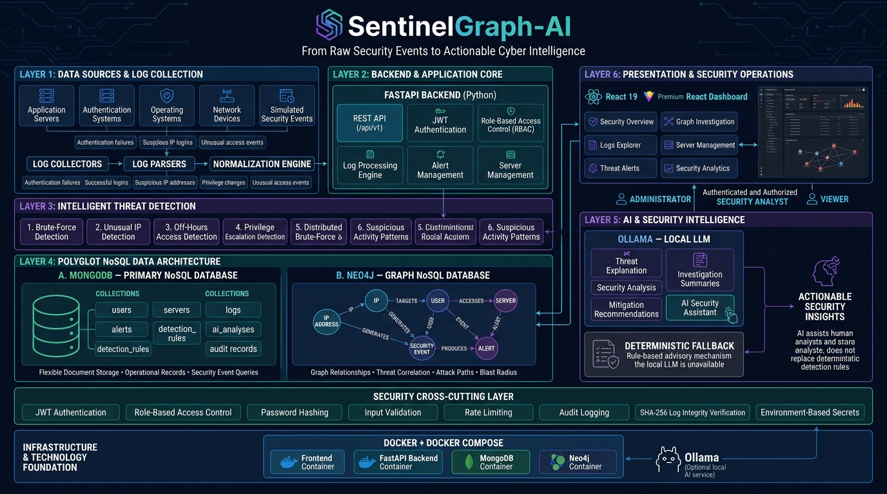
</p>

---

### 2. Application Interface & Security Monitoring

The following screenshots showcase the application's main interface, centralized log management, security alerts, and monitoring capabilities.

<table>
  <tr>
    <td width="50%" align="center">
      <strong>Security Dashboard</strong><br/><br/>
      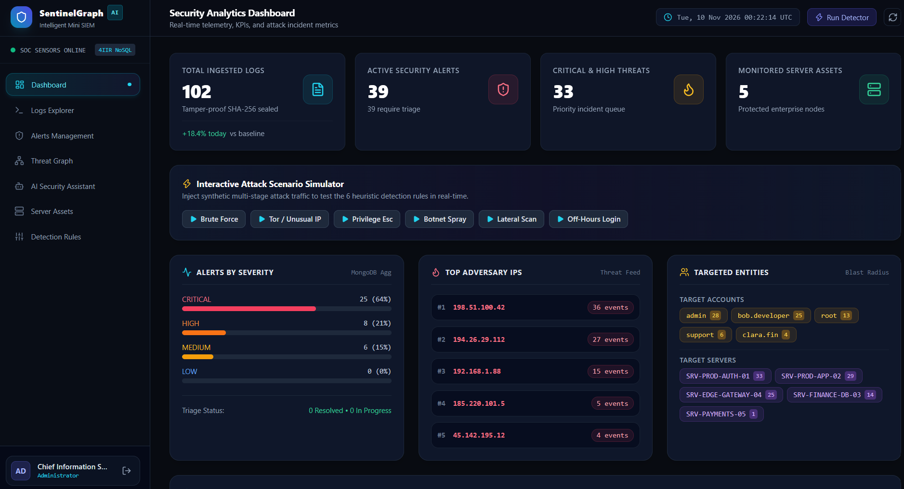
    </td>
    <td width="50%" align="center">
      <strong>Centralized Log Management</strong><br/><br/>
      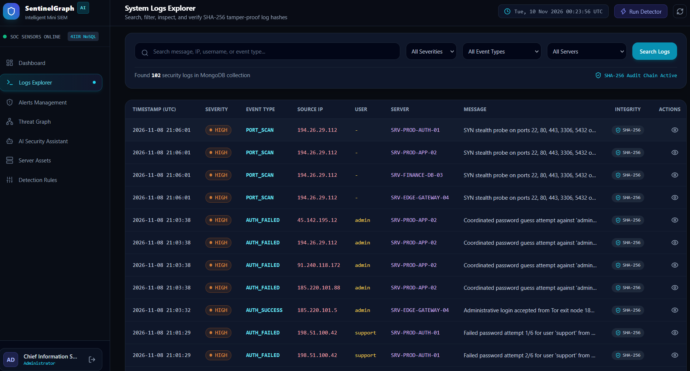
    </td>
  </tr>
  <tr>
    <td width="50%" align="center">
      <strong>Security Alerts</strong><br/><br/>
      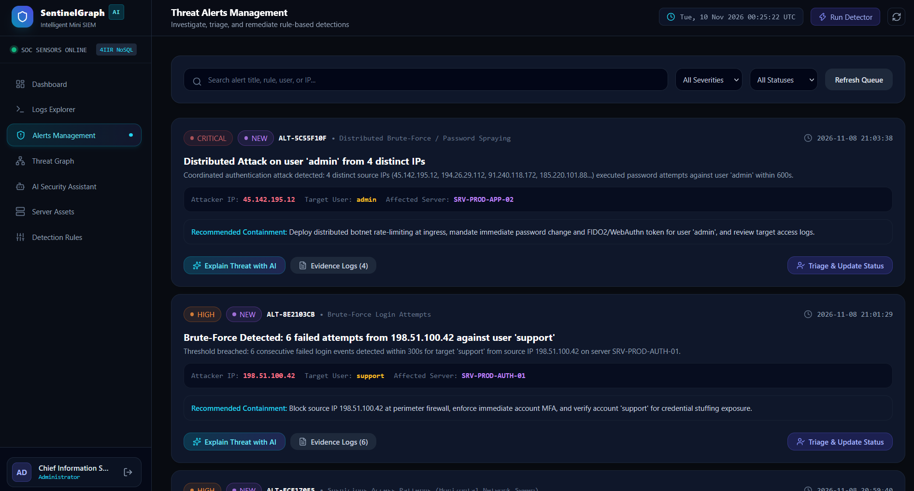
    </td>
    <td width="50%" align="center">
      <strong>Alert Investigation</strong><br/><br/>
      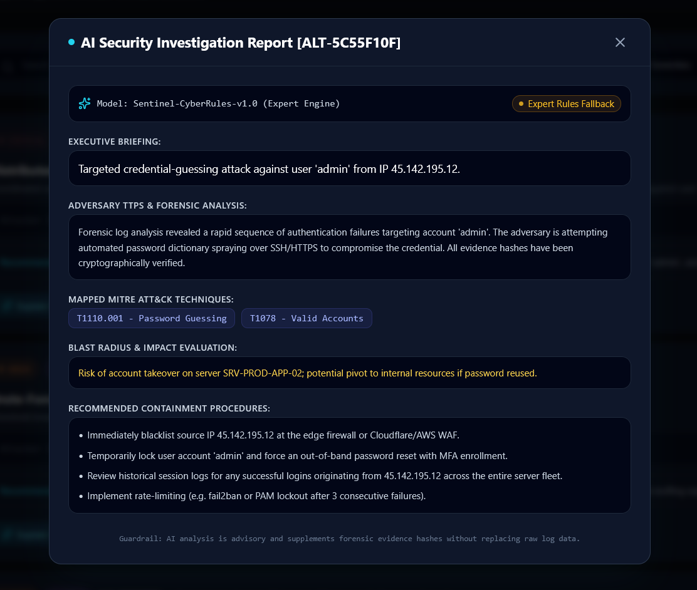
    </td>
  </tr>
</table>

---

### 3. Threat Intelligence, Detection & AI Analysis

This section presents the security intelligence capabilities, including threat investigation, detection mechanisms, infrastructure monitoring, and AI-powered security analysis.

<table>
  <tr>
    <td width="50%" align="center">
      <strong>Threat Intelligence</strong><br/><br/>
      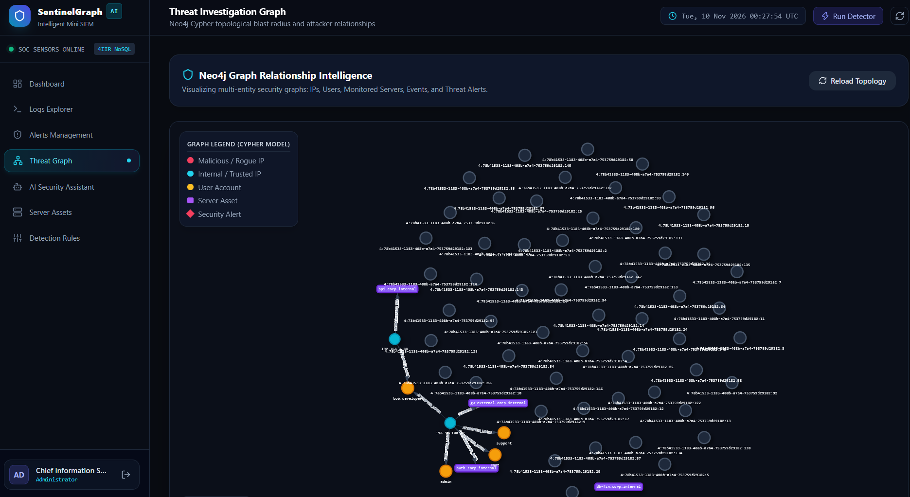
    </td>
    <td width="50%" align="center">
      <strong>AI Security Analysis</strong><br/><br/>
      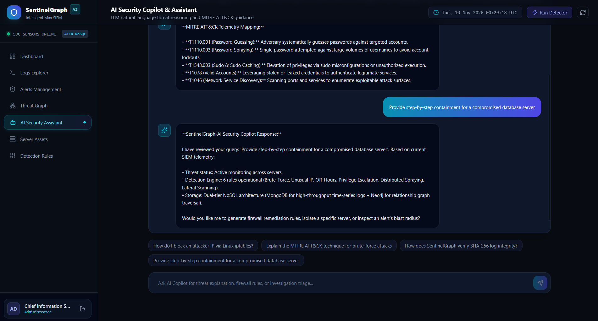
    </td>
  </tr>
  <tr>
    <td width="50%" align="center">
      <strong>Server Monitoring</strong><br/><br/>
      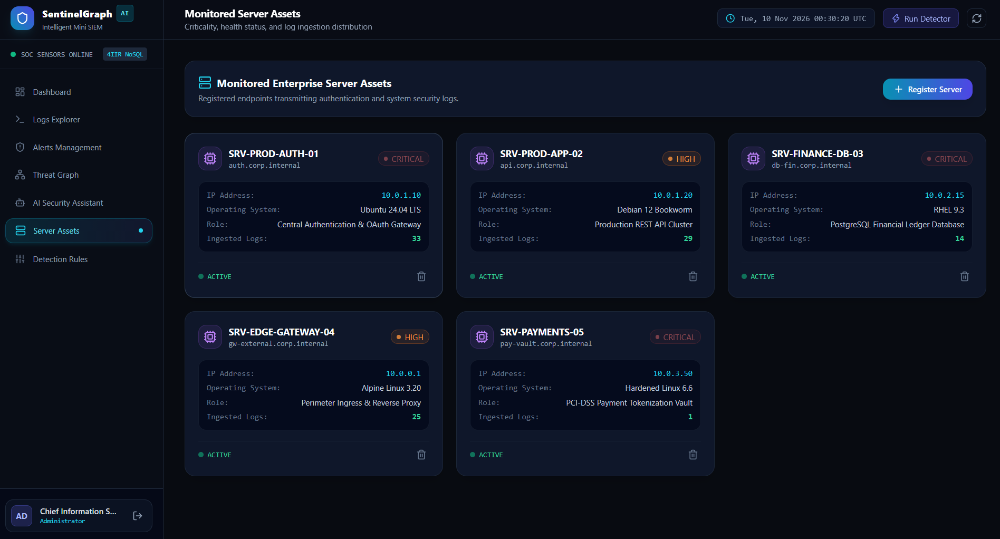
    </td>
    <td width="50%" align="center">
      <strong>Threat Detection Engine</strong><br/><br/>
      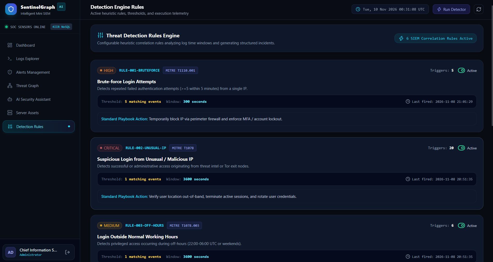
    </td>
  </tr>
</table>

---

## 1. The Problem: Security Visibility Is an Enterprise Challenge

Modern organizations depend on interconnected information systems, servers, applications, user accounts, and network infrastructures. Every interaction generates valuable security information.

However, collecting security logs is not enough. The real challenge is understanding what these events mean, identifying suspicious patterns, and connecting isolated activities to recognize potential attacks.

Organizations commonly face several security challenges:

| Enterprise Challenge | Business and Security Impact |
|---|---|
| Fragmented security logs | Events are distributed across multiple systems, making centralized monitoring difficult. |
| Limited threat visibility | Suspicious activities can remain unnoticed among thousands of legitimate events. |
| Brute-force attacks | Repeated authentication failures may indicate attempts to compromise user accounts. |
| Unusual access patterns | Connections from suspicious IP addresses or outside normal working hours can indicate potential threats. |
| Privilege escalation | Unauthorized changes in access privileges can expose critical organizational resources. |
| Isolated security events | Individual events may appear harmless while their relationships reveal a coordinated attack. |
| Manual investigation | Security analysts spend valuable time correlating evidence and understanding incidents. |
| Delayed response | Late identification of suspicious activities increases organizational exposure. |

**The fundamental problem is not the lack of security data. It is the difficulty of transforming distributed security events into meaningful, connected, and actionable intelligence.**

## 2. The Solution: SentinelGraph-AI

SentinelGraph-AI addresses these challenges through an integrated security monitoring and investigation architecture.

The platform follows a complete security intelligence workflow:

1. **Collect:** Centralize security logs from multiple simulated servers and applications.
2. **Normalize:** Transform heterogeneous events into structured and consistent documents.
3. **Analyze:** Evaluate incoming events against configurable security detection rules.
4. **Detect:** Identify suspicious activities and generate structured security alerts.
5. **Correlate:** Explore relationships between users, IP addresses, servers, events, and alerts through graph analysis.
6. **Explain:** Use AI-assisted analysis to interpret security evidence and provide investigation insights.
7. **Monitor:** Present security activity, threat distributions, and incident information through a centralized dashboard.

The objective is to move beyond isolated log monitoring toward a more connected and intelligent approach to security analysis.

## 3. Core Capabilities

### 3.1 Centralized Security Log Management

A unified log management layer provides visibility into security events generated by different infrastructure components.

Capabilities include:
- Collection and ingestion of security events.
- Log parsing and normalization.
- Structured event storage.
- Filtering, searching, and pagination.
- Severity and event classification.
- Source IP, user, and server identification.
- Per-record integrity verification using SHA-256.

### 3.2 Intelligent Threat Detection

The detection engine evaluates security events against six detection families.

| Detection Rule | Security Objective |
|---|---|
| Brute-Force Detection | Identify repeated failed authentication attempts. |
| Unusual IP Detection | Identify suspicious login sources. |
| Off-Hours Access | Detect access outside expected working hours. |
| Privilege Escalation | Identify potentially unauthorized privilege changes. |
| Distributed Brute Force | Identify coordinated authentication attempts involving multiple sources. |
| Suspicious Activity Patterns | Identify potentially abnormal sequences of security events. |

Each generated alert contains structured security information, including severity, affected assets, event evidence, timestamps, and investigation details.

### 3.3 Alert Management and Incident Investigation

The alert management module centralizes detected threats and supports analyst investigation.

Key capabilities:
- Severity classification: Critical, High, Medium, and Low.
- Alert lifecycle management.
- Investigation status tracking.
- Evidence retrieval.
- Analyst notes.
- Alert history and contextual information.

The platform distinguishes between detecting a suspicious event and investigating its actual security implications.

### 3.4 Graph-Based Threat Investigation

Security incidents are rarely isolated.

An IP address may target multiple accounts, a compromised user may access several servers, and different alerts may originate from related events.

Traditional document queries are useful for retrieving individual records, but exploring multi-level relationships becomes more complex.

SentinelGraph-AI integrates Neo4j to represent and investigate these relationships.

**Conceptual threat graph:**

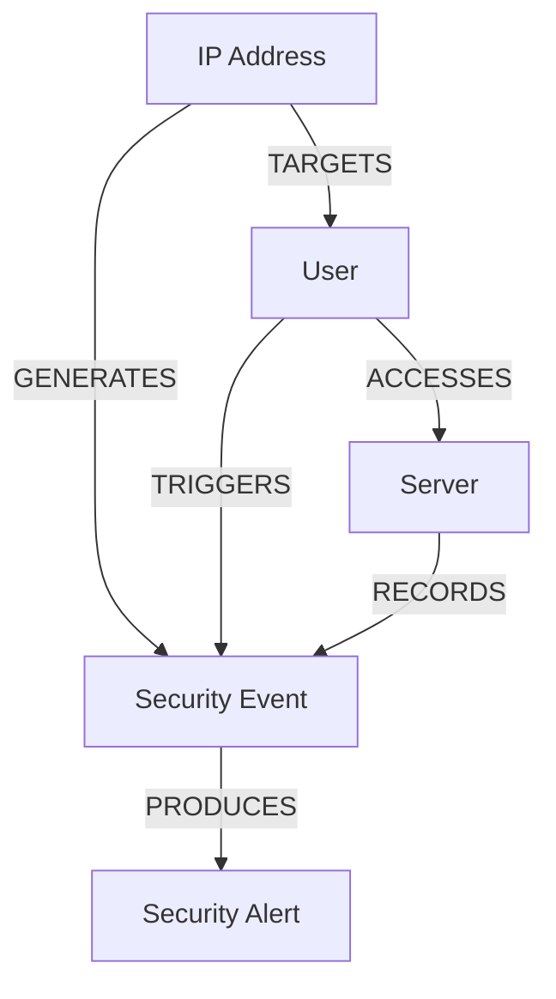

Graph investigation capabilities include:

- Security topology exploration.
- Repeated attacker identification.
- Relationship discovery between incidents.
- Blast-radius investigation.
- Attack-path exploration.
- Identification of connected suspicious entities.

This approach helps analysts understand not only what happened, but also how different security events may be connected.

## 4. Artificial Intelligence: From Detection to Understanding

SentinelGraph-AI integrates an optional local AI layer through Ollama.

Its purpose is to improve the interpretation of security evidence rather than replace the detection engine.

| AI Capability | Purpose |
|---|---|
| Threat Explanation | Explain why an event or alert may be suspicious. |
| Security Analysis | Interpret available detection evidence. |
| Investigation Summaries | Produce contextual summaries of security incidents. |
| Mitigation Recommendations | Suggest possible actions to investigate or reduce exposure. |
| Security Assistant | Provide a natural-language interface for security-related questions. |

### Hybrid Intelligence Architecture

The platform separates deterministic security detection from AI-generated interpretation.

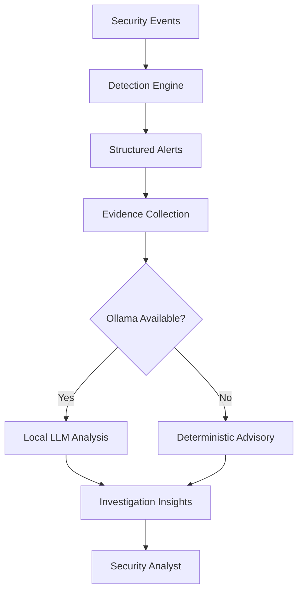

**Important design principle:** AI-generated explanations are advisory. Actual detection decisions remain grounded in explicit security rules and available evidence.

When Ollama is unavailable, the platform provides a clearly identified deterministic, rule-based advisory instead of pretending that an LLM analysis was performed.

## 5. Architecture & Technology Stack

SentinelGraph-AI follows a modular full-stack architecture that separates presentation, application logic, operational data storage, graph investigation, and AI-assisted analysis.

### Technology Stack

| Layer | Technology | Responsibility |
|---|---|---|
| Frontend | React 19 | User interface and application components |
| Language | TypeScript | Type safety and maintainable frontend development |
| Build Tool | Vite | Frontend development and production builds |
| Web Server | Nginx | Frontend serving |
| Backend | Python + FastAPI | Business logic and REST API |
| Authentication | JWT | Authenticated API access |
| Authorization | Role-Based Access Control | Permission enforcement |
| Primary Database | MongoDB | Operational security documents |
| Graph Database | Neo4j | Threat relationships and graph traversal |
| AI Integration | Ollama | Local LLM-based analysis |
| Containerization | Docker | Application service isolation and deployment |
| Orchestration | Docker Compose | Multi-service architecture |

### High-Level System Architecture

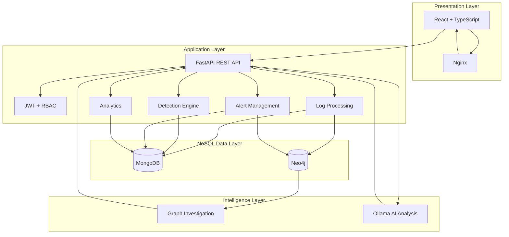

## 6. NoSQL Database Architecture

A major architectural decision in SentinelGraph-AI is the use of two complementary NoSQL database technologies.

Rather than forcing every type of data into one storage model, the platform assigns each database a responsibility that matches its strengths.

### 6.1 MongoDB — Primary Operational Database

MongoDB is the primary source of operational application records.

It stores structured and semi-structured security information generated throughout the application lifecycle.

| Collection | Purpose |
|---|---|
| `users` | User accounts, roles, and authentication information |
| `servers` | Monitored server inventory |
| `logs` | Normalized security events |
| `alerts` | Generated security alerts and investigation state |
| `detection_rules` | Configurable detection rules |
| `ai_analyses` | AI-assisted analysis history |
| Audit records | Tracked administrative and security-related actions |

**Why MongoDB?**

Security events have different structures depending on their origin. A flexible document model makes it practical to ingest, normalize, store, filter, and retrieve heterogeneous security records.

MongoDB provides the operational persistence layer for the application.

### 6.2 Neo4j — Graph-Based Security Intelligence

Neo4j complements MongoDB by managing relationships between security entities.

| Graph Node | Description |
|---|---|
| `IP` | Source or suspicious network address |
| `User` | Account involved in a security event |
| `Server` | Infrastructure asset |
| `Event` | Recorded security activity |
| `Alert` | Detected security incident |

Example graph relationships:

- `(:IP)-[:TARGETS]->(:User)`
- `(:User)-[:ACCESSES]->(:Server)`
- `(:IP)-[:GENERATES]->(:Event)`
- `(:Event)-[:PRODUCES]->(:Alert)`

**Why Neo4j?**

A document database is appropriate for storing individual security events, but complex relationship traversal requires additional query logic.

Neo4j enables graph-oriented investigation, helping analysts discover connections between apparently unrelated security incidents.

### 6.3 Polyglot Persistence Strategy

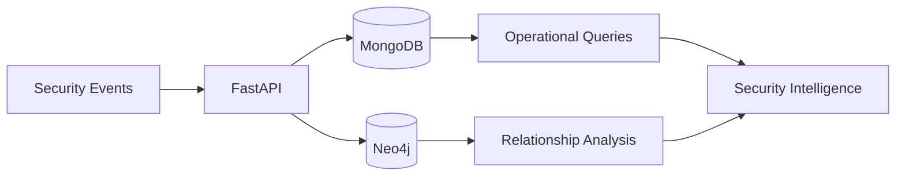

| Database | Primary Responsibility |
|---|---|
| MongoDB | Document storage and operational queries |
| Neo4j | Relationship modeling and graph investigation |

This architecture demonstrates **Polyglot Persistence**: using multiple database technologies according to their respective strengths.

## 7. Security Architecture

Security is both the subject of the application and a fundamental requirement of its implementation.

SentinelGraph-AI incorporates several security mechanisms:

| Mechanism | Implementation Purpose |
|---|---|
| JWT Authentication | Authenticate users accessing protected resources |
| Role-Based Access Control | Enforce permissions according to user roles |
| Password Hashing | Avoid storing passwords in plaintext |
| Input Validation | Validate API payloads and incoming data |
| Rate Limiting | Reduce exposure to excessive API requests |
| Audit Logging | Maintain records of relevant application actions |
| SHA-256 Integrity Verification | Verify individual log records against their integrity hashes |
| Environment-Based Secrets | Keep sensitive configuration outside source-controlled files |

### User Roles

| Role | Intended Responsibility |
|---|---|
| Administrator | Manage users, infrastructure assets, and detection configuration |
| Security Analyst | Monitor events, investigate alerts, and analyze threats |
| Viewer | Access authorized monitoring and analytical information |

Backend authorization is enforced through protected API dependencies and role checks, rather than relying exclusively on frontend visibility.

## 8. Data Processing Lifecycle

The platform follows a structured pipeline to transform raw security events into investigation-ready information.

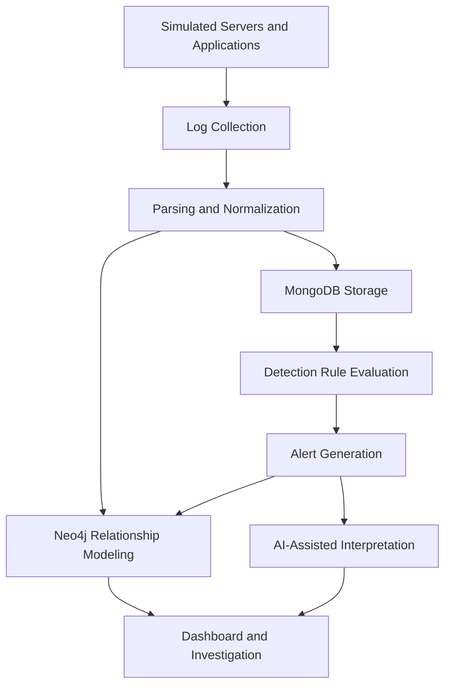

This pipeline establishes a clear separation between event ingestion, operational persistence, deterministic detection, relationship investigation, and AI-assisted interpretation.

## 9. Backend API Overview

The backend exposes versioned REST endpoints under `/api/v1`.

| Module | Endpoint | Responsibility |
|---|---|---|
| Authentication | `/auth` | Login, user profile, and user administration |
| Logs | `/logs` | Ingestion, retrieval, simulation, and integrity verification |
| Alerts | `/alerts` | Alert retrieval, investigation, updates, and detection |
| Analytics | `/analytics/dashboard` | Security KPIs and event distributions |
| Servers | `/servers` | Monitored infrastructure management |
| Rules | `/rules` | Detection rule configuration |
| Graph | `/graph` | Threat topology, attackers, blast radius, and attack paths |
| AI | `/ai` | Threat analysis, assistant interactions, and analysis history |

The interactive OpenAPI specification is exposed by FastAPI.

## 10. Analytics & Security Visibility

The dashboard consolidates operational and security information to provide a unified view of the monitored environment.

Key analytical indicators include:

- Total collected security logs.
- Total generated alerts.
- Critical and high-severity incidents.
- Threat severity distribution.
- Top suspicious IP addresses.
- Most targeted users and servers.
- Security events over time.
- Recent security incidents.

The purpose is to make security activity easier to understand and to help analysts prioritize investigation efforts.

## 11. Project Organization

The application follows a modular repository structure separating backend responsibilities, frontend components, data assets, scripts, and technical documentation.

```text
SentinelGraph-AI/
│
├── backend/
│   ├── app/
│   │   ├── api/
│   │   ├── core/
│   │   ├── database/
│   │   ├── collectors/
│   │   ├── parsers/
│   │   ├── detection/
│   │   ├── graph/
│   │   ├── ai/
│   │   ├── models/
│   │   └── main.py
│   └── tests/
│
├── frontend/
│   └── src/
│       ├── components/
│       ├── pages/
│       ├── layouts/
│       ├── services/
│       ├── hooks/
│       └── types/
│
├── data/
│   ├── raw/
│   ├── processed/
│   └── samples/
│
├── scripts/
├── docs/
│   ├── architecture/
│   ├── uml/
│   └── screenshots/
│
├── docker-compose.yml
├── .env.example
├── .gitignore
└── README.md
```

## 12. Engineering Principles

SentinelGraph-AI is designed around the following engineering principles:

- **Modularity:** Separate application responsibilities into maintainable components.
- **Separation of Concerns:** Distinguish data persistence, detection, graph analysis, and AI interpretation.
- **Polyglot Persistence:** Select database technologies according to data access patterns.
- **Security by Design:** Integrate authentication, authorization, validation, and auditability.
- **Explainability:** Keep detection evidence available for analyst investigation.
- **Graceful Degradation:** Preserve core functionality when the optional AI service is unavailable.
- **Extensibility:** Allow additional detection rules, log sources, and graph relationships to be introduced.

## 13. Project Scope & Limitations

SentinelGraph-AI is an academic cybersecurity engineering prototype designed to demonstrate the architecture and implementation of an intelligent log monitoring and threat investigation platform.

Its current scope includes simulated security telemetry, rule-based detection, graph-based investigation, and optional local AI analysis.

The project does not claim to be a certified enterprise SIEM, a replacement for commercial threat intelligence platforms, or a production-hardened security monitoring solution.

In particular:

- Sample telemetry is illustrative, not live threat intelligence.
- Detection rules are configurable application logic, not a complete intrusion detection system.
- AI-generated recommendations require human validation.
- The fallback advisory is deterministic and is not equivalent to LLM inference.
- Production deployment would require additional infrastructure hardening, access controls, operational monitoring, and security validation.

Clearly defining these limitations is essential to evaluating the platform accurately.

## 14. Future Development Opportunities

Potential extensions include:

| Area | Possible Enhancement |
|---|---|
| Log Collection | Integration with real operating system and application log sources |
| Threat Intelligence | External IP reputation and threat intelligence feeds |
| Detection | Advanced anomaly detection and behavioral analytics |
| Correlation | More sophisticated multi-event attack correlation |
| Graph Analysis | Historical attack-path reconstruction |
| AI | Evidence-grounded investigation using retrieval-augmented generation |
| Monitoring | Real-time event streaming and notification mechanisms |
| Scalability | Distributed ingestion and processing architecture |
| Security | Additional hardening, automated security testing, and deployment controls |

These directions provide opportunities to evolve the prototype into a more comprehensive security analytics platform.

## 15. Project Information

| Attribute | Description |
|---|---|
| Project | SentinelGraph-AI |
| Category | Cybersecurity / Security Information and Event Management |
| Architecture | Full-Stack, Multi-Database NoSQL |
| Primary Database | MongoDB |
| Graph Database | Neo4j |
| Backend | Python / FastAPI |
| Frontend | React / TypeScript |
| AI Integration | Ollama |
| Deployment Technology | Docker / Docker Compose |
| Academic Context | 4IIR — NoSQL Application Development |

---

## Final Perspective

Security monitoring should not stop at collecting logs or generating alerts.

The real value comes from understanding the relationships between events, identifying suspicious behavior, connecting evidence, and supporting informed security decisions.

**SentinelGraph-AI brings together document-oriented storage, graph intelligence, deterministic threat detection, and local AI-assisted analysis to demonstrate how raw security telemetry can become structured, connected, and actionable cyber intelligence.**

<p align="center">
  **From Security Events to Threat Intelligence.**
  <br/>
  **From Isolated Logs to Connected Insights.**
</p>

---

*SentinelGraph-AI — An academic project exploring the intersection of NoSQL engineering, cybersecurity, graph analytics, and artificial intelligence.*
